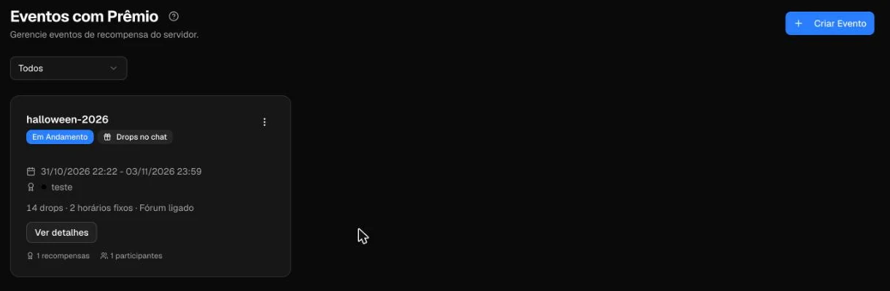
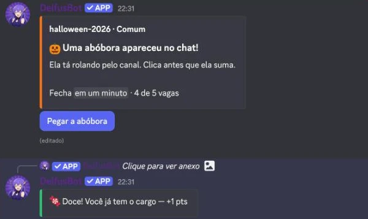
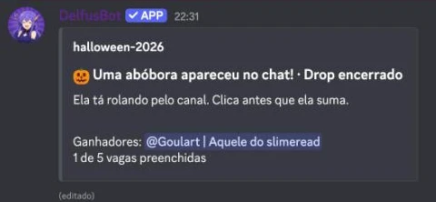
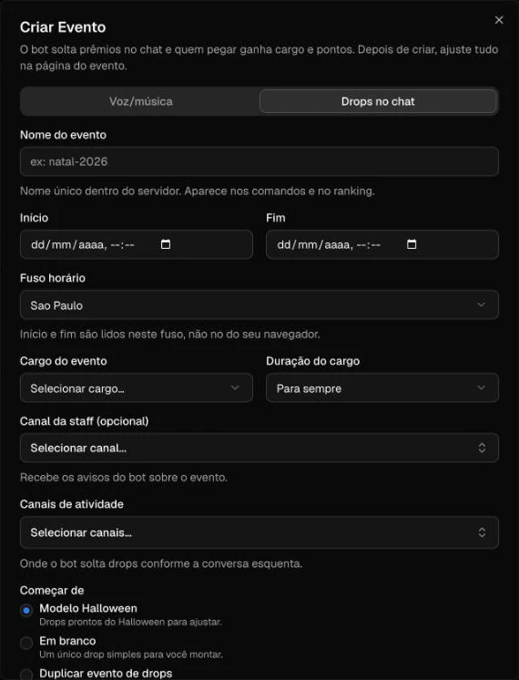
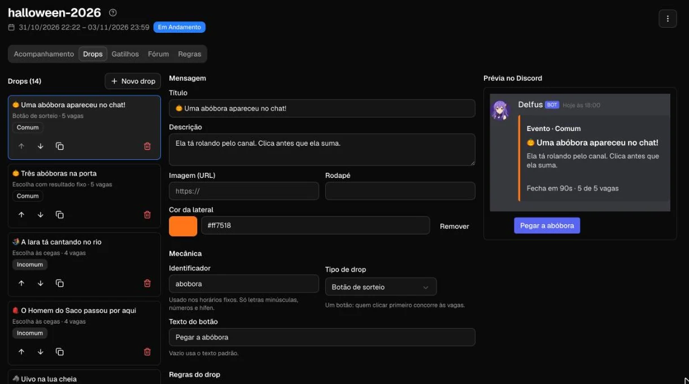
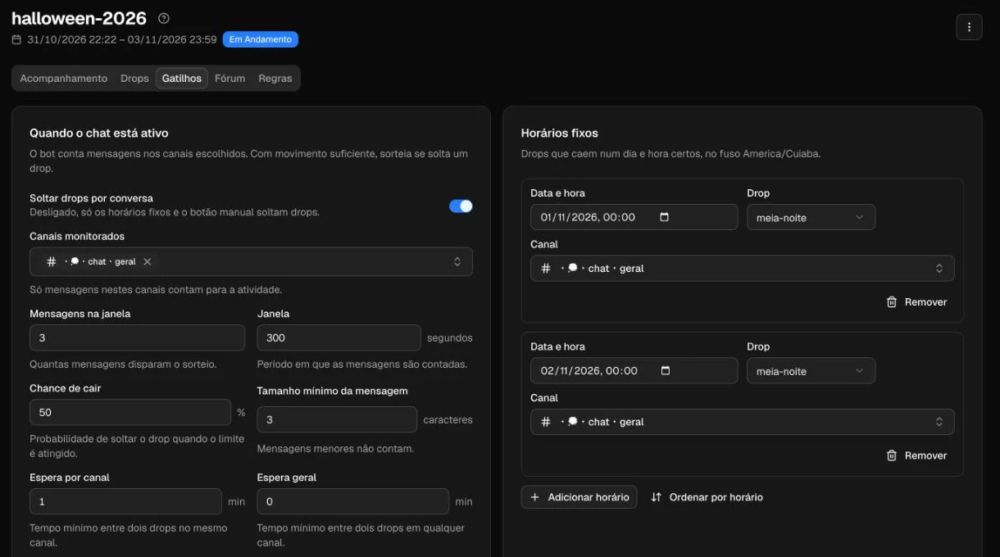
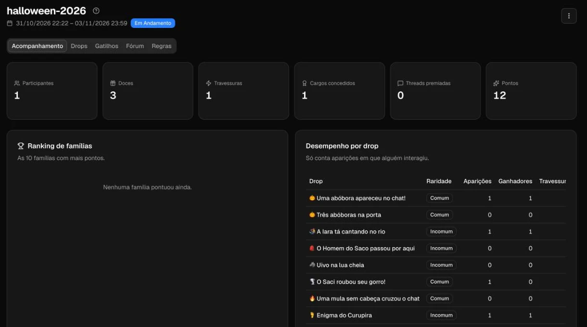
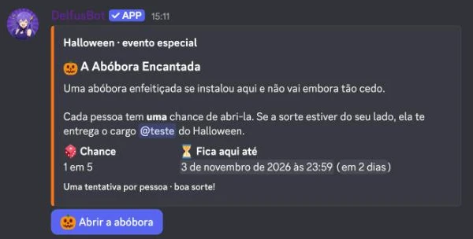

# Eventos com drops

Faça o chat do seu servidor Discord ficar de olho. Num evento com drops, o Delfus solta mensagens-surpresa nos canais: quem for rápido (ou der sorte) leva um cargo exclusivo e pontos pro ranking das famílias. Dá pra rodar um evento de Halloween, de Natal, de aniversário do servidor ou qualquer data que você quiser.

Tudo é configurado no [Dashboard](https://admin.delfus.app/dashboard/events/premiados), no menu **Eventos**.

{ .dx-shot width="1220" height="400" fetchpriority=high }

## Como funciona

Um **drop** é uma mensagem (um embed com título, descrição, cor e imagem) que o bot solta no chat. Cada drop tem uma **mecânica**: a galera clica num botão, digita uma palavra, escolhe uma opção ou responde um quiz. O resultado cai em um de três:

- **Doce**: a pessoa ganha o cargo do evento e pontos.
- **Travessura**: não ganha nada (e, se você quiser, recebe um cargo de travessura por alguns minutos).
- **Vazio**: não ganha nada, sem drama.

Regras que valem pra todo drop:

- Cada pessoa tem **uma tentativa por drop**.
- O resultado aparece **só pra quem clicou**, numa mensagem colorida que só a pessoa vê.
- O embed mostra "N de M vagas" e o tempo restante ao vivo.
- O drop fecha quando o tempo acaba ou as vagas enchem. Aí o embed fica cinza e lista os ganhadores.

{ .dx-shot width="600" height="357" loading=lazy style="max-width:600px" }

{ .dx-shot width="480" height="222" loading=lazy style="max-width:480px" }

!!! example "Exemplo"
    O Delfus solta um drop "Uma abóbora apareceu!" no `#geral` com 2 vagas e 5 minutos. A primeira pessoa clica e tira doce: ganha o cargo "Caçador de Doces" e 10 pontos. A segunda clica e cai em travessura. Com as vagas cheias, o embed fica cinza com a lista dos ganhadores.

## Como fazer drops no seu servidor

Passo a passo, do zero até o primeiro drop caindo.

### 1. Prepare o cargo e as permissões

1. Crie no Discord o **cargo de recompensa** do evento (por exemplo, "Caçador de Doces").
2. Se quiser travessura com castigo, crie também um **cargo de travessura**.
3. Arraste o **cargo mais alto do Delfus** para **acima** dos cargos do evento. Sem isso o bot não consegue entregar o cargo e avisa a staff no canal configurado.
4. Escolha um **canal da staff** para receber os avisos do bot.

### 2. Crie o evento

1. Abra o menu **Eventos** no [painel](https://admin.delfus.app/dashboard/events/premiados) e clique em **Criar Evento**.
2. Escolha o tipo **Drops no chat**. (O outro tipo é o de Voz/música.)
3. Escolha o ponto de partida:
    - **Modelo Halloween**: já vem com drops prontos.
    - **Em branco**: você monta tudo.
    - **Duplicar evento existente**: reaproveita a configuração de outro evento.
4. Defina o **nome**, o **período** (início e fim, com fuso horário), o **cargo de recompensa** e o **canal da staff**.

{ .dx-shot width="570" height="746" loading=lazy style="max-width:570px" }

### 3. Monte os drops

Na aba **Drops**, crie cada drop com:

- **Mensagem**: título, descrição, cor, imagem e rodapé. O editor mostra uma **prévia igual ao Discord**.
- **Mecânica**: veja a [lista abaixo](#as-mecanicas).
- **Raridade**: comum, incomum ou raro.
- **Duração**: de 15 segundos a 1 hora.
- **Vagas**: quantas pessoas ganham antes de fechar (até 100).
- **Chance de travessura** e **chance de vazio**.
- **Limite por dia**: quantas vezes esse drop pode cair por dia.
- **Pontos**: um valor na primeira vez e outro quando a pessoa já tem o cargo.
- **Textos** de vitória, travessura, vazio e "chegou atrasado", mais o **rótulo do botão**.

Dá pra reordenar, duplicar e remover drops. Comece com uns 3 a 5 drops de raridades diferentes.

{ .dx-shot width="1220" height="680" loading=lazy }

### 4. Defina quando os drops caem

Na aba **Gatilhos**, escolha o **chat ativo** (o drop cai quando o canal está movimentado), os **horários fixos**, ou os dois. Detalhes na seção [Gatilhos](#gatilhos).

### 5. Ajuste as regras

Na aba **Regras**, confira período, cargo, duração do cargo, pontos padrão e o antiabuso (idade mínima na conta no servidor, cargos excluídos, máximo de doces por dia). Veja [Regras e antiabuso](#regras-e-antiabuso).

### 6. Salve e teste

1. Clique em salvar na barra do rodapé. **Tudo é salvo de uma vez**. Se o evento já estiver no ar, o painel pede confirmação.
2. As mudanças valem em **até 1 minuto**.
3. No menu da página do evento, use **Soltar drop agora**: escolha o drop e o canal e veja ele cair. O botão fica bloqueado se houver alterações não salvas ou se o evento estiver fora do período.

!!! warning "Antes de lançar"
    Faça o teste num servidor de teste ou num canal só da staff. Confira se o cargo foi entregue e se o cargo do bot está acima do cargo do evento.

## As mecânicas

Cada drop usa uma destas cinco:

| Mecânica | Nome no painel | Como funciona |
| --- | --- | --- |
| `botao_sorteio` | **Botão** | A pessoa clica e torce: o sorteio decide entre doce, travessura ou vazio. |
| `escolha` | **Escolha às cegas** | Várias opções. A distribuição de doce, travessura e vazio é embaralhada a cada drop, então ninguém decora a certa. |
| `escolha_fixa` | **Escolha com resultado fixo** | Várias opções, cada uma com resultado definido por você. |
| `digitar` | **Digitar a palavra** | O primeiro (ou os primeiros) a digitar uma das respostas aceitas no chat ganha. Ignora maiúsculas e acentos. A mensagem certa é apagada e o bot responde. |
| `quiz` | **Quiz** | Pergunta com opções. Errou, perdeu a vez. |

## Gatilhos

Na aba **Gatilhos** você decide o que faz o drop cair.

### Chat ativo

Nos canais escolhidos, quando há **X mensagens numa janela de tempo**, existe **Y% de chance** de cair um drop. Para não virar bagunça:

- **Cooldown** por canal e global.
- **Tamanho mínimo** da mensagem para contar.
- **Intervalo por usuário** (anti-spam): quem manda mensagem em rajada não conta várias vezes.
- **Pesos por raridade**: definem qual drop é sorteado (comuns mais frequentes, raros mais raros).
- Cada drop pode ficar **fora do sorteio por atividade**, caindo só em horário fixo ou manualmente.

### Horários fixos

Escolha **data e hora** (no fuso do evento), o **drop** e o **canal**. Ótimo para abrir o evento com estardalhaço ou marcar um drop especial no fim de semana.

{ .dx-shot width="1220" height="680" loading=lazy }

## Fórum

A aba **Fórum** premia posts de fórum que geram conversa. Quando um post atinge **N respostas de M pessoas diferentes**, o autor ganha o cargo e pontos. Você configura:

- **Tags permitidas**: só posts com essas tags participam.
- **Limite de recompensas por autor**.
- A **reação 🎃** e a **mensagem de resposta** do bot.

## Regras e antiabuso

A aba **Regras** reúne:

- **Período e fuso** do evento e **cargo do evento**.
- **Duração do cargo**: para sempre ou só até o fim do evento.
- **Pontos padrão** e **chance de travessura padrão**.
- **Cargo de travessura** (e por quantos minutos ele dura).
- **Antiabuso**: idade mínima no servidor (em dias), cargos excluídos e máximo de doces por pessoa por dia.

!!! note "Um cargo por evento"
    Quem já tem o cargo do evento e tira doce de novo ganha só os **pontos de repetição**.

## Pontos e famílias

Os pontos somam para a pessoa e para a **família** dela no Delfus, alimentando o ranking de famílias. Veja mais em [Famílias](familia.md).

## Comandos

Para a staff:

| Comando | O que faz |
| --- | --- |
| `/evento drop` | Solta um drop agora. |
| `/evento historico` | Mostra o histórico de uma pessoa no evento. |
| `/evento conceder` | Dá a recompensa manualmente. |
| `/evento revogar` | Tira a recompensa. |
| `/evento ranking` | Mostra o ranking do evento. |

## Acompanhamento

A aba **Acompanhamento** mostra o evento em andamento: participantes, doces, travessuras, ranking das famílias e os últimos ganhadores.

{ .dx-shot width="1220" height="680" loading=lazy }

No menu da página você ainda tem **Exportar JSON** e **Importar JSON**. Use para guardar a configuração e reaproveitar em outros eventos (Natal, aniversário do servidor etc.).

## Drop permanente

Recurso avançado, hoje montado pela equipe do Delfus. É um **botão fixo num canal** que vale até o fim do evento, com **uma tentativa por pessoa** e chance de ganhar o cargo. Quem não ganha é convidado a acompanhar os drops que caem no chat. Quer um no seu servidor? Fale com a gente no [servidor de suporte](https://discord.gg/mTjZg95UJV).

{ .dx-shot width="600" height="304" loading=lazy style="max-width:600px" }

## Dicas

!!! tip "Para começar bem"
    - Comece com **chance baixa** de queda por atividade e suba aos poucos olhando o Acompanhamento.
    - Use um **canal movimentado**: o chat ativo depende de conversa pra disparar.
    - Misture mecânicas e raridades pra o evento não ficar repetitivo.
    - **Teste num servidor de teste** antes de abrir pra todo mundo.
    - Salve a configuração com **Exportar JSON** pra reutilizar no próximo evento.

## Perguntas frequentes

### O cargo não foi entregue. O que houve?
Confira se o cargo mais alto do Delfus está **acima** do cargo do evento. Se não estiver, o bot avisa a staff no canal configurado.

### Posso soltar um drop manualmente?
Pode. Use **Soltar drop agora** no painel ou `/evento drop` no Discord.

### Cada pessoa pode tentar mais de uma vez?
Não. É uma tentativa por drop. Em outro drop, tenta de novo.

### Minhas alterações não apareceram. E agora?
Elas valem em até 1 minuto depois de salvar. Se o botão de **Soltar drop agora** estiver bloqueado, salve as alterações pendentes ou confira se o evento está dentro do período.

### Dá pra dar ou tirar a recompensa na mão?
Dá. A staff usa `/evento conceder` e `/evento revogar`.

### Dá pra reaproveitar um evento?
Sim: ao criar, escolha **Duplicar evento existente**, ou use **Exportar JSON** e **Importar JSON**.

Veja também: [Famílias](familia.md), [Cargos automáticos](auto-roles.md), [Mensagens e embeds](mensagens.md), [Starboard](starboard.md).
