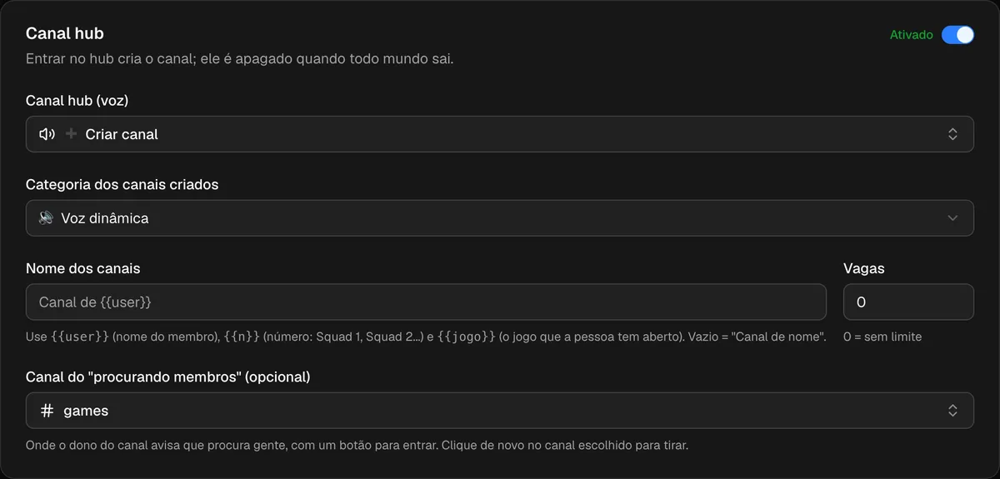
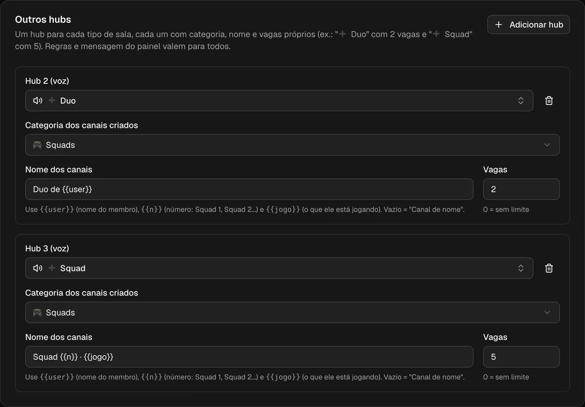
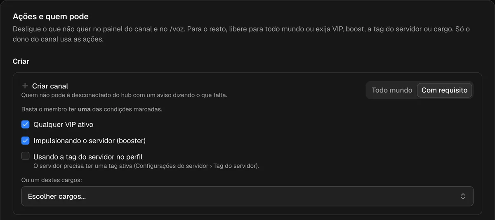

# Voz dinâmica

Cada membro entra num canal **➕ Criar canal** e o Delfus cria na hora um canal de voz só dele, já com o membro dentro. O dono controla o canal por um painel com dois menus ou pelo comando `/voz`: muda nome e vagas, tranca, esconde, libera ou bloqueia gente, convida amigos. Quando o último sai, o canal some.

Acaba a lista de "Sala 1, Sala 2, Sala 3" vazias e a equipe não precisa ficar arrumando canal de voz.

## Configurar em 1 minuto

1. Num canal de texto qualquer, use **`/voz setup`**. Precisa de **Gerenciar servidor**.
2. Clique em **Criar em 1 clique**. O Delfus cria a categoria **Voz dinâmica** com o canal **➕ Criar canal** dentro.
3. Entre em **➕ Criar canal**. Você vai para o seu canal novo, e o painel de controle aparece no chat dele.

Pronto. O resto é opcional.

!!! tip "Já tem um canal de voz que quer usar como entrada?"
    Na mesma tela do `/voz setup`, escolha o canal no menu **Ou use um canal de voz que já existe**. Ele vira o canal de entrada (o "hub") e os canais novos nascem na categoria dele.

### O que dá para ajustar no `/voz setup`

A tela do `/voz setup` mostra se a função está ligada, qual é o canal de entrada e se falta alguma permissão ao Delfus. Nela você também:

- **Liga ou desliga** a voz dinâmica.
- Escolhe o **canal do "procurando membros"**: o canal de texto onde os donos avisam que procuram gente. Sem ele, essa ação fica escondida.
- Marca quais **ações aparecem no painel** dos canais. Desmarque o que não quer que os donos usem (por exemplo, ocultar o canal).

O que não cabe no Discord fica no painel web, em **Ajustes no painel**.

## No painel web

Em [admin.delfus.app](https://admin.delfus.app) → **Voz dinâmica** você tem tudo do `/voz setup` e mais:

{ .dx-shot width="1200" height="575" loading=lazy }

- **Nome dos canais**: um modelo com variáveis. `{{user}}` é o nome do membro, `{{n}}` é um número (Squad 1, Squad 2...) e `{{jogo}}` é o que ele está jogando. Vazio, o nome fica "Canal de *nome*".
- **Vagas**: quantas pessoas cabem no canal novo. 0 é sem limite.
- **Categoria**: onde os canais novos aparecem. Por padrão, na mesma categoria do canal de entrada.
- **Outros hubs**: até 5 canais de entrada a mais, cada um com categoria, nome e vagas próprios.
- **Quem pode usar cada ação**: criar canal, renomear, trancar, convidar e as outras podem exigir VIP ativo, um VIP específico, impulsionar o servidor, usar a tag do servidor no perfil ou ter um cargo.
- **Mensagem do painel**: troque o texto do painel do canal pelo seu, no mesmo editor das outras mensagens do Delfus. Os menus continuam embaixo.

{ .dx-shot width="1200" height="836" loading=lazy }

!!! example "Exemplo: um hub para cada tamanho de grupo"
    - **➕ Duo**: 2 vagas, nome `Duo de {{user}}`.
    - **➕ Squad**: 5 vagas, nome `Squad {{n}} · {{jogo}}`.

    A Ana entra em **➕ Squad** jogando Valorant e ganha "Squad 1 · Valorant". O próximo ganha "Squad 2". Quando o Squad 1 esvazia e some, o número 1 volta a ficar livre.

!!! example "Exemplo: criar canal só para quem apoia o servidor"
    Em **Criar canal**, exija **impulsionar o servidor** ou **VIP ativo**. Quem não cumpre e entra no ➕ recebe uma mensagem dizendo o que falta, e o Delfus tira a pessoa do canal de entrada.

    { .dx-shot width="1200" height="535" loading=lazy }

## O painel do canal

Quando o canal nasce, o Delfus posta no chat dele um painel com dois menus. Só o dono consegue usar, e o menu volta ao normal depois de cada escolha.

**⚙️ Configurações do canal**

| Opção | O que faz |
| --- | --- |
| ✏️ Renomear | Muda o nome do canal. |
| 👥 Limite de vagas | Quantas pessoas cabem. 0 tira o limite. |
| 💬 Status | O texto que aparece embaixo do nome do canal, na lista. |
| 🎚️ Qualidade do áudio | O bitrate em kbps. Mais kbps deixa o áudio melhor e gasta mais internet. O máximo depende do nível de impulso do servidor. |
| 🌎 Região | O servidor de voz mais perto de vocês (Brasil, EUA, Europa...). Ajuda quando a voz está atrasada. |
| 📣 Procurando membros | Posta no canal escolhido pela equipe que o seu canal procura gente, com um botão **Entrar no canal**. |

**🛡️ Quem entra no canal**

| Opção | O que faz |
| --- | --- |
| 🔒 Trancar / abrir | Quem está dentro fica, ninguém novo entra. Quem você liberar continua entrando. |
| 👻 Ocultar / mostrar | O canal some da lista para quem não está dentro nem foi liberado. |
| ✅ Liberar alguém | Um membro ou cargo entra mesmo com o canal trancado ou oculto. |
| ⛔ Bloquear alguém | Um membro ou cargo não entra mais, e quem estiver dentro sai da call. |
| ✉️ Convidar | Manda uma mensagem direta com um botão para o canal, e já libera a entrada da pessoa. |
| 🔁 Passar o canal | Outra pessoa que está no canal vira a dona. |
| 👑 Assumir o canal | Quando o dono saiu, quem ficou pode virar dono. |

## Comandos

Tudo do painel também funciona por comando, de qualquer canal do servidor. Você só precisa estar no seu canal de voz.

| Comando | O que faz |
| --- | --- |
| `/voz setup` | Abre a configuração rápida. Pede **Gerenciar servidor**. |
| `/voz painel` | Posta de novo o painel no chat do seu canal. |
| `/voz nome` | Renomeia o canal. |
| `/voz limite` | Define as vagas (0 a 99). |
| `/voz status` | Define o status do canal. Sem texto, remove. |
| `/voz bitrate` | Escolhe a qualidade do áudio. |
| `/voz regiao` | Escolhe a região do servidor de voz. |
| `/voz procurando` | Avisa que o canal procura gente, com uma mensagem opcional. |
| `/voz trancar` | Tranca ou abre o canal. |
| `/voz ocultar` | Oculta ou mostra o canal. |
| `/voz permitir` | Libera um membro ou cargo. |
| `/voz bloquear` | Bloqueia um membro ou cargo e tira da call. |
| `/voz convidar` | Convida um membro por mensagem direta, com recado opcional. |
| `/voz transferir` | Passa o canal para quem está nele. |
| `/voz assumir` | Assume o canal quando o dono já saiu. |

Se o servidor ainda não ligou a voz dinâmica, o `/voz` avisa. Quem pode configurar vê o botão **Ativar agora**. Os outros membros recebem uma dica para pedir à equipe.

## Limites

Alguns limites existem para ninguém usar o bot para fazer spam:

- **Renomear**: o Discord só deixa mudar o nome de um canal 2 vezes a cada 10 minutos. O Delfus avisa quanto falta.
- **Convidar**: até 3 convites a cada 10 minutos por pessoa.
- **Procurando membros**: 1 aviso a cada 10 minutos por canal.
- **Bloquear**: não dá para bloquear você mesmo, um bot ou alguém da equipe (quem tem **Mover membros**).
- **Criar**: quem sai e entra no ➕ várias vezes seguidas espera alguns segundos antes de ganhar outro canal.

## Permissões do Delfus

O Delfus precisa destas permissões na categoria dos canais e no canal de entrada:

| Permissão | Para quê |
| --- | --- |
| **Ver canal** | Enxergar o canal de entrada e os canais criados. |
| **Conectar** | Continuar entrando no canal depois que o dono tranca. |
| **Gerenciar canais** | Criar, renomear e apagar os canais. |
| **Gerenciar cargos** | Trancar, ocultar, liberar e bloquear (mexe nas permissões do canal). |
| **Mover membros** | Levar o membro para o canal novo e tirar quem foi bloqueado. |

O `/voz setup` confere isso e mostra o que falta, se faltar.

## Resolução de problemas

??? question "Entro no ➕ e nada acontece"
    1. Abra o `/voz setup` e veja se está **Ligada** e se o canal de entrada é o certo.
    2. Veja se a tela avisa que falta permissão. O mais comum é faltar **Mover membros** ou **Gerenciar canais** na categoria.
    3. Se o servidor exige algo para criar canal (VIP, impulso, tag ou cargo), quem não cumpre recebe uma mensagem e é tirado do ➕. Confira em **Quem pode usar cada ação**, no painel web.

??? question "O canal foi criado, mas os menus dizem que não consegui alterar"
    O Delfus perdeu **Gerenciar cargos** ou **Gerenciar canais** naquele canal. Isso acontece quando a categoria tem uma permissão negando o cargo do Delfus. Libere as permissões da tabela acima na categoria.

??? question "Tranquei o canal e eu mesmo não consigo voltar"
    Não acontece com o dono: o dono sempre entra no próprio canal. Se você saiu e outra pessoa assumiu o canal, peça para ela liberar você com **Liberar alguém**.

??? question "A ação \"Procurando membros\" não aparece"
    Ela só aparece quando a equipe escolhe o canal de texto onde os avisos vão. Faça isso no `/voz setup` ou no painel web.

??? question "Uma ação sumiu do menu"
    A equipe desligou essa ação no servidor. Ela pode ser ligada de novo no `/voz setup`, em **Ações liberadas no painel do canal**.

??? question "O convite não chegou na pessoa"
    Ela está com as mensagens diretas fechadas para o servidor. O Delfus avisa quando isso acontece. Mesmo assim, ela já está liberada para entrar no canal: mande o link do canal por outro lugar.

??? question "Como pego o ID de um canal?"
    No Discord, vá em **Configurações de usuário → Avançado** e ligue o **Modo desenvolvedor**. Depois clique com o botão direito no canal e escolha **Copiar ID do canal**. No `/voz setup` e no painel web você não precisa de ID: é só escolher o canal na lista.
